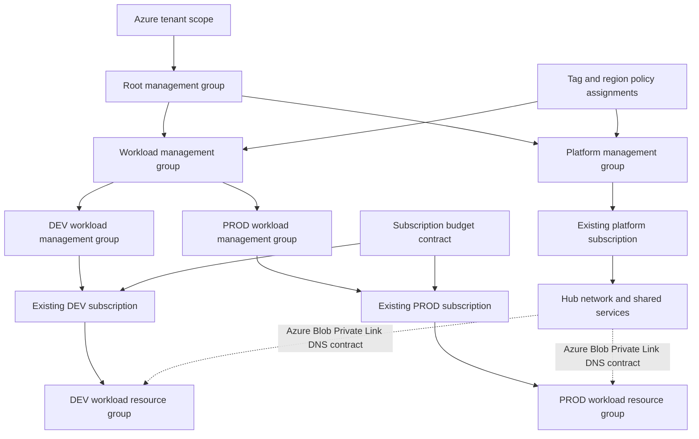

# Azure Cloud Platform Architecture Reference

A local-only reference project that demonstrates an enterprise Azure platform design through scoped Bicep, environment contracts, policy-as-code examples, and repeatable static validation.

It is an architecture reference project, not a production deployment.

## What is implemented

- Tenant, management-group, subscription, and resource-group Bicep entry points with explicit scope boundaries.
- A single landing-zone hierarchy with separate DEV and PROD workload management-group boundaries that deliberately does **not** create or move subscriptions.
- Custom Azure Policy examples for `environment`, `owner`, `costCenter`, `dataClassification`, and approved regions.
- Distinct environment contracts: DEV assigns `Audit`; PROD assigns `Deny`.
- Least-privilege Reader role-assignment and user-assigned managed-identity patterns using placeholders only.
- Bounded hub/spoke virtual-network and private-DNS modules.
- A subscription budget module and FinOps ownership-tag contract.
- A diagnostic-setting input contract that avoids making unverified provider-category claims.
- Python standard-library contract tests and Bicep build/lint validation.

## Architecture



See [architecture documentation](docs/architecture.md), [security and governance](docs/security-governance.md), [operations](docs/operations.md), and [ADRs](docs/adr/).

## Repository layout

```text
infra/
  tenant/                 # Tenant-scope management-group hierarchy
  management-group/       # Policy definitions and assignments
  subscription/           # Existing-subscription baseline and budget
  resource-group/         # Network, identity, RBAC, diagnostics contracts
  modules/                # Reusable Bicep modules
  params/dev/             # DEV Audit-oriented placeholder inputs
  params/prod/            # PROD Deny-oriented placeholder inputs
scripts/validate-local.sh # Build, lint, parameter compile, contract tests
tests/                    # Local static contract tests
docs/                     # Architecture, governance, operations, ADRs
```

## Tooling baseline

The Phase 0 local smoke test used:

| Tool | Verified version |
|---|---:|
| Azure CLI | 2.78.0 |
| Bicep CLI | 0.49.2 |
| Python | 3.12 or newer required for local contract tests |

No Azure login, Azure deployment, or cloud-resource operation was performed for this project.

## Local validation

Install Bicep locally without authenticating to Azure:

```bash
az bicep install
az bicep version
```

Run every Bicep build, Bicep lint, parameter compilation, and static contract test:

```bash
cd azure-cloud-platform-architecture-reference
export BICEP_COMMAND="$HOME/.azure/bin/bicep"
./scripts/validate-local.sh
```

If Bicep is installed elsewhere, set `BICEP_COMMAND` to that executable. Validation writes generated ARM JSON only to `/tmp/azure-cloud-platform-architecture-reference-validation/` by default. Override it with `LOCAL_VALIDATION_OUTPUT_DIR` when a controlled ephemeral location is required.

The validation script intentionally does **not** invoke `az login`, `az deployment`, `az group create`, or any Azure resource command.

### What local validation proves

- Bicep templates and parameter files compile with the local Bicep toolchain.
- Bicep linter rules run for each `.bicep` file.
- Static tests confirm deployment scope declarations, DEV/PROD policy effects, placeholder-only parameters, and the absence of a GitHub Actions workflow.

### What it does not prove

Local validation is **not Azure deployment validation**, RBAC verification, Azure Policy compliance certification, network connectivity validation, or a production-readiness certification. It is not compliance certification. A real deployment would require separately approved Azure identities, existing target scopes, provider-specific API/category checks, and change control.

## Scope contracts

| Scope | Entry point | Responsibility | Explicit boundary |
|---|---|---|---|
| Tenant | `infra/tenant/main.bicep` | One hierarchy: root, platform, workload, DEV workload, PROD workload groups | Does not create or move subscriptions |
| Management group | `infra/management-group/main.bicep` | Custom tag/region policies and assignments | No universal PaaS public-network policy claim |
| Subscription | `infra/subscription/main.bicep` | Workload resource-group and budget baseline | Targets an existing subscription selected by operator |
| Resource group | `infra/resource-group/main.bicep` | Hub/spoke module selection, identity/RBAC patterns, diagnostic contract | No provider-specific diagnostic deployment without validated categories |

## Configuration and secrets

Parameter files contain only illustrative labels and `example.invalid` notification addresses. They contain no tenant IDs, subscription IDs, principal IDs, workspace IDs, tokens, or credentials.

In a real controlled environment, deployment target selection, Entra principal IDs, workspace IDs, and notification recipients must be supplied through approved environment-specific configuration and secret-management processes. They must not be committed to this repository.

## Databricks, AI, and workload boundaries

This project describes the Azure platform foundation only. It does not deploy application workloads, AI services, Databricks, networking appliances, private endpoints, or a centralized logging workspace. Such components need separate provider-specific modules and approved deployment evidence.

## Limitations

- No Azure deployment, authentication, subscription validation, or resource provisioning has occurred.
- Policy aliases are intentionally limited to generic tag and location controls. Service-specific public-network and diagnostic policies must be validated against the target resource provider.
- Hub/spoke peering, firewall policy, DNS links, private endpoints, and diagnostic categories are documented architecture contracts; they are not proven by local compilation. The Private Link DNS example is Azure Blob Storage only.
- Budget notifications use non-routable example addresses and must be replaced only through approved operational configuration.
- No GitHub Actions workflow is included. Verification is designed to run locally or in a controlled environment.

## License

MIT License. See [LICENSE](LICENSE).
