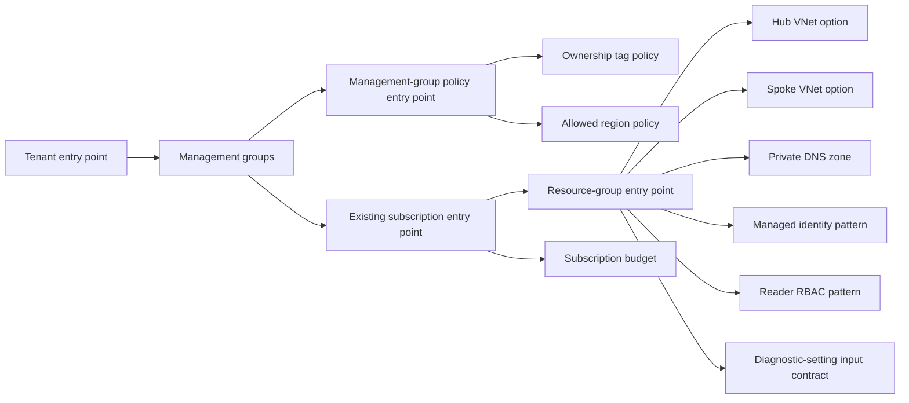
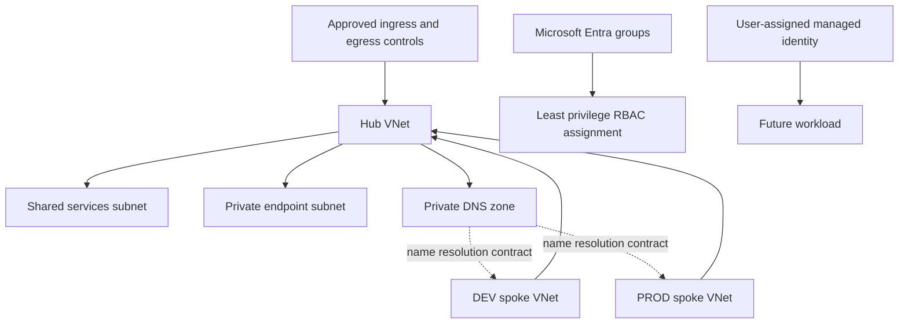

# Architecture and deployment boundaries

## Design intent

The reference separates logical cloud-platform responsibilities from the Azure deployment scopes capable of expressing them. It provides deployable-shape Bicep and static checks, but intentionally makes no Azure API call.

## Deployment hierarchy

| Layer | Valid Bicep `targetScope` | Purpose | Not implied |
|---|---|---|---|
| Tenant | `tenant` | Creates the management-group hierarchy | Subscription creation, subscription movement, tenant configuration |
| Management group | `managementGroup` | Defines and assigns generic tag/region policies | Universal resource-provider security enforcement |
| Subscription | `subscription` | Creates a named workload resource-group baseline and a budget shape | New subscription placement or billing configuration |
| Resource group | `resourceGroup` | Expresses network, identity, RBAC, and diagnostics contracts | Connectivity, identity authorization, or logging-category success |

### Existing subscription boundary

The subscription template is deployed only after a caller selects an existing target subscription in a separately approved deployment operation. Parameter files use a descriptive boundary label rather than a subscription ID. The tenant template does not use subscription-alias resources, subscription APIs, or a subscription-placement mechanism.

## Network and security topology

The Bicep modules intentionally model bounded VNet and private-DNS components. Peering, route tables, firewall appliances, private endpoint resources, and DNS links remain deployment-specific because they require validated resource IDs, network ownership, and provider constraints.

## Operations and diagnostics boundary

The diagnostic-setting module is an explicit input contract: target-resource ID plus Log Analytics workspace ID. It does not create a `Microsoft.Insights/diagnosticSettings` resource because log categories and valid diagnostic targets differ by provider. Before a real deployment, the owning team must validate category names, destination retention, network access, and data-residency requirements.

## Transaction and recovery model

Bicep deployments are Azure Resource Manager operations, but this repository does not invoke them. Local compilation is stateless and produces generated JSON under `.local/`. Therefore there is no local deployment state, rollback, or Azure resource recovery claim. A future controlled deployment must define its own change window, deployment history, rollback strategy, and validation evidence.
